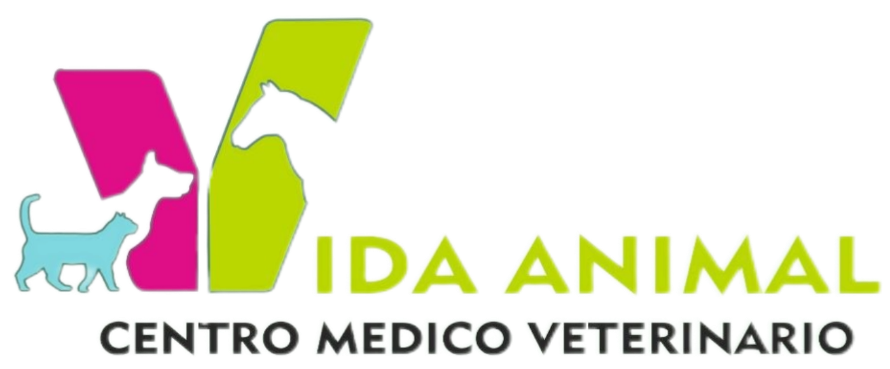

<div align="center">
  

  <h3>Sitio web oficial de Vida Animal, Centro Médico Veterinario en La Dorada, Caldas</h3>

  <p>
    <a href="https://vida-animal.netlify.app/"><strong>Ver sitio en vivo »</strong></a>
    ·
    <a href="https://www.instagram.com/vida_animal_ladorada/">Instagram</a>
  </p>

  <p>
    
    
    
    
  </p>
</div>

---

## Sobre el proyecto

Landing page de una sola página para **Vida Animal**, una clínica veterinaria de La Dorada (Caldas, Colombia). El objetivo del sitio es que cualquier persona pueda conocer los servicios, la clínica y a la médica a cargo, y **comunicarse en un clic por WhatsApp o llamada**, los canales que más usan sus clientes.

La identidad visual sigue la del negocio en redes sociales: los colores del logo (magenta, verde lima y cian), fotos reales de la clínica y sus pacientes, y un tono cercano.

### Secciones

| Sección | Contenido |
| --- | --- |
| **Inicio** | Mensaje principal y acceso directo para agendar por WhatsApp |
| **Servicios** | Consulta, vacunación, cirugía y hospitalización, laboratorio, profilaxis dental y baño, cada uno con su mensaje de WhatsApp prellenado |
| **Nosotros** | Historia de la clínica, la doctora y los valores del servicio |
| **Pacientes** | Galería de pacientes reales |
| **Tienda** | Alimentos, accesorios y medicamentos |
| **Visítanos** | Dirección, mapa de Google, horarios y teléfono |
| **Contacto** | WhatsApp y llamada directa |

### Características

- Diseño responsive pensado primero para móvil.
- Botón flotante de WhatsApp siempre visible.
- Imágenes optimizadas con `next/image` (lazy loading y placeholder borroso).
- Metadatos SEO y Open Graph para buscadores y redes sociales.
- Accesible: HTML semántico, textos alternativos, foco visible y respeto por `prefers-reduced-motion`.
- Redirecciones permanentes desde las rutas antiguas (`/AboutUs`, `/Services`, `/Contact`) a su sección.

## Tecnologías

- [Next.js 13](https://nextjs.org/) (App Router), con generación estática
- [React 18](https://react.dev/)
- [Tailwind CSS 3](https://tailwindcss.com/)
- [React Icons](https://react-icons.github.io/react-icons/)
- Fuentes Fredoka y Nunito vía `next/font`

## Cómo ejecutarlo

Requisitos: Node.js 18 o superior.

```bash
git clone https://github.com/castolo10a/Vida-Animal.git
cd Vida-Animal
npm install
npm run dev
```

El sitio queda disponible en `http://localhost:3000`.

| Script | Descripción |
| --- | --- |
| `npm run dev` | Servidor de desarrollo |
| `npm run build` | Build de producción |
| `npm run start` | Sirve el build de producción |
| `npm run lint` | Revisión con ESLint |

## Estructura

```
├── app/
│   ├── data.js          # Datos del negocio: teléfono, horarios, servicios, galería
│   ├── layout.js        # Metadatos SEO y fuentes
│   ├── page.jsx         # Página única que compone las secciones
│   ├── not-found.jsx    # Página 404
│   └── globals.css      # Estilos base y componentes de Tailwind
├── components/
│   ├── Header.jsx       # Navegación fija y menú móvil
│   ├── Footer.jsx
│   ├── WhatsAppButton.jsx
│   └── sections/        # Hero, Services, About, Patients, Store, Visit, Contact
├── assets/              # Logo y fotografías de la clínica
└── tailwind.config.js   # Paleta de colores de la marca
```

### Actualizar la información del negocio

Los datos que cambian con más frecuencia están centralizados en [`app/data.js`](app/data.js): número de teléfono, enlace de Instagram, dirección, horarios, servicios (texto, foto y mensaje de WhatsApp) y fotos de la galería. Para cambiar algo de esto no hace falta tocar los componentes.

## Despliegue

El sitio se despliega en [Netlify](https://www.netlify.com/) con cada push a `main`.

---

<div align="center">
  Desarrollado por <a href="https://fullstack-colombia.netlify.app/">CastilloCoder</a>
</div>
